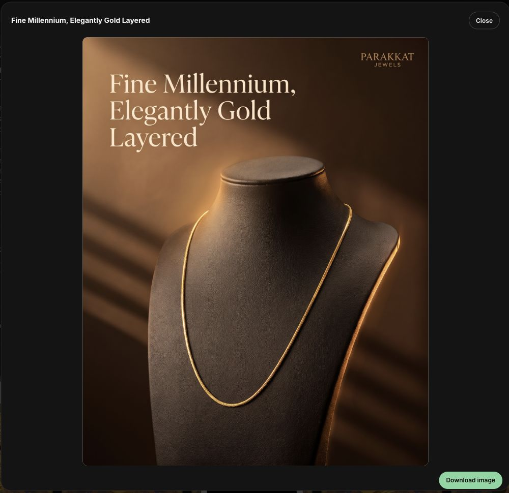
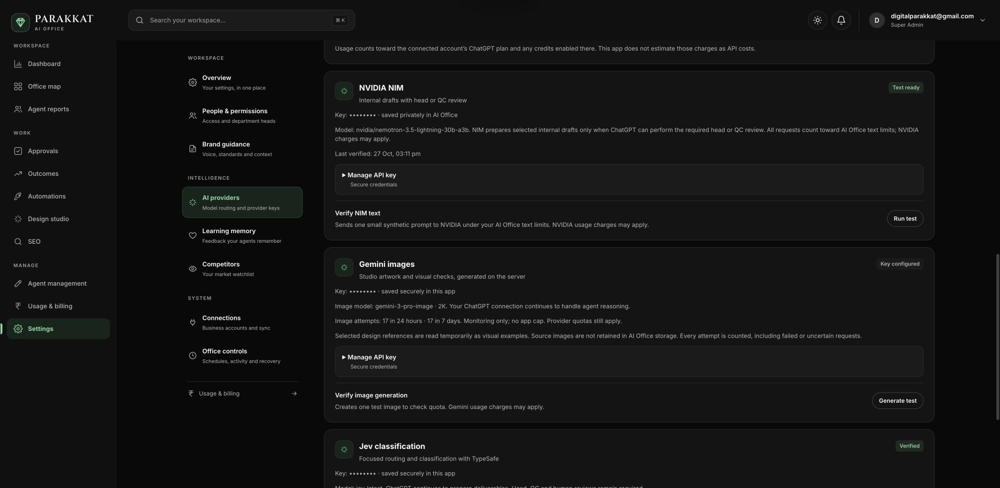

# Usage monitoring and image quality — 28 October 2026

The application-owned rolling text/image caps are disabled in production. Usage reservations, token counts and cost reporting remain intact; provider quotas and explicit manual pause still apply. Monthly spending is a monitoring target rather than a global automatic pause. Per-request bounds remain finite (100,000 input characters and up to 8,000 output tokens); small classification/review calls continue requesting less.

## Quality and efficiency

- Gemini generation defaults to `gemini-3-pro-image` at 2K, with explicit deployment overrides supported. Final images are distinguished from intermediate thought images.
- Original selected Drive reference pixels and their fingerprints are supplied to generation and review. Reads are transient, deduplicated, revision-checked and bounded to three examples; imported originals are not copied into AI Office storage. Unreadable or changed references stop before generation instead of silently becoming text-only guidance.
- Creative Director direction and image quality/product checks are mandatory. Corrections remain bounded to one repeat, and uncertain calls are not automatically replayed on another paid provider.
- Conversation and head-task changes preserve detailed specialist work, source evidence and revision requirements through final drafting and review. Repeated revisions do not reuse stale cached answers.
- Pro image accounting separates actual final-image cost from text/thinking tokens, retains provider totals, and labels estimates when modality information is missing. Existing custom prices are preserved.

Reference examples condition generation; these changes do not train or fine-tune Gemini's model weights. A stronger model and preserved evidence improve the pipeline but do not guarantee every result will equal a chosen reference. Existing failed drafts and their history remain visible.

## Initial deployment

Release: `quality-pro-20261028-r1`.

- Immutable image: `sha256:82c9f22de9e7252001ee0d8ca27e4e1ca0b522640a701f29f1cb3be08e677fd6`.
- Source manifest: `b749da9f704e2f4f620c6b28f1caae1c248c54dfbdcf6d2e8fbdf59424b017d7` (524 files).
- Applied `20261028000100_usage_monitoring.sql` and `20261028000200_gemini_pro_prices.sql` together atomically. Verified both cap switches false, image blocked false even at the previous 17/day threshold, all three Pro resolution price rows, and `api_usage.cost_note`.
- 856 tests passed, none failed or skipped; TypeScript and production Docker build passed.
- App and scheduler were updated; all 22 unrelated containers were verified unchanged. Existing credentials, networks, resource ceilings and runtime environment were preserved. Dedicated builder stopped; only the owned temporary maintenance pause was restored.
- Live configuration and model access verified as Pro/2K; connected ChatGPT provider available. No inference was used for these configuration checks.
- Pre-upgrade rollback image retained as `parakkat-ai-office:before-quality-pro-20261028-r1`.

## Reference selection follow-up

Release `quality-pro-20261028-r2` is live. Immutable image: `sha256:0bee5ecf789d590f8262f0671e70a6c1c0cf65d96f904bdba2adede8a8da5581`; source manifest `cf94a95a0afc4be4938a81bc9b9ac405a18be181e9b6f256748f824956614855` (527 files).

The old selector omitted the selected product and redesign note, used broad keyword matches and random variety, and excluded previous references. It could choose idol/gifting advertisements for a chain. Selection now ranks product identity/category and manager direction before popularity, uses a primary reference with compatible supporting examples, and keeps a strong previous reference eligible. Negative style directions are excluded from positive matches. Chain bracelets and showroom displays do not outrank actual chain advertisements. Selection uses metadata rather than a new model call.

The current 190 ready references fit within the 500-row metadata scan; larger libraries receive bounded indexed subject/direction supplements. This bound may omit some relevant examples in much larger libraries. Database failures stop generation; a legitimately empty library retains the existing explicit no-reference flow. Explicitly selected carousel references remain unchanged.

865 tests passed, none failed or skipped; TypeScript, whitespace checks and the production build passed. The same office-only rollout checks passed, the builder stopped, and the temporary maintenance pause was cleared. No additional SQL migration was required. All 22 unrelated services and protected credential/resource settings remained unchanged.

## Live visual validation

Fine Millennium design `859f552f-f858-4f47-8c71-94c05cc3e23f` completed v3 and remains an unpublished, unrated human-review draft. Versions 1 and 2 were retained. The new JPEG is 1856 × 2304 pixels, consistent with the requested Pro 2K 4:5 output.

- Exactly one image reservation and one successful `gemini-3-pro-image` request, beyond the previous 17/day app allowance; no correction image or provider fallback was needed. Image request elapsed time: 32.953 seconds.
- Original selected Drive revisions were read successfully. Primary reference: `PCH60-083.jpg`; supporting references: `PCX103-057.jpg` and `PCPN37-006.jpg`.
- Creative Director: 2,222 input / 396 output tokens. The 11,149-character prompt was accepted with an 8,000-token maximum; the provider generated only what the response needed.
- Generation: 3,897 input / 1,643 total output tokens; estimated API cost $0.14807. Visual review: 7,877 input / 597 output tokens; estimated API cost $0.0081465. Combined recorded API estimate: $0.1562165. ChatGPT plan usage is recorded separately and is not priced as an API call. These entries are correlated by the isolated design/time window, since the ledger does not carry a standalone design ID.
- Automated visual review passed. Independent visual comparison found more coherent warm lighting, sharper material/chain detail and a cleaner scene than v2, readable unchanged headline, and no additional jewellery, ceremonial props, offers or claim badges.
- Human-review limits: the chain still reads as a fine, flattened curb chain, but exact SKU/link geometry cannot be certified from the generated image. Some highlights look rounder than the original source's flattened faces. The PARAKKAT wordmark changed from the earlier draft's sans-serif lettering to serif lettering. The output is a new render, not an unchanged copy of the original Shopify pixels. Automated QC is not proof of exact identity or final brand approval.

No good/bad rating or publishing approval was submitted. No other saved design or carousel set was regenerated.

[Live design in Studio](https://ai-office.parakkatjewels.in/studio#d-859f552f-f858-4f47-8c71-94c05cc3e23f)

This record's final validation section and screenshots were added locally after the immutable release archive was built; runtime source was not changed after deployment.

## Sources

- [Gemini Pro image model](https://ai.google.dev/gemini-api/docs/models/gemini-3-pro-image)
- [Gemini image generation](https://ai.google.dev/gemini-api/docs/generate-content/image-generation)
- [Gemini pricing](https://ai.google.dev/gemini-api/docs/pricing)
- [NVIDIA FLUX.2 Klein hosted interface](https://docs.api.nvidia.com/nim/reference/black-forest-labs-flux_2-klein-4b-infer)

The available NVIDIA hosted preview interface was unsuitable for arbitrary product/reference input in this workflow; Gemini Pro uses the existing private connection and supports the required image references.
